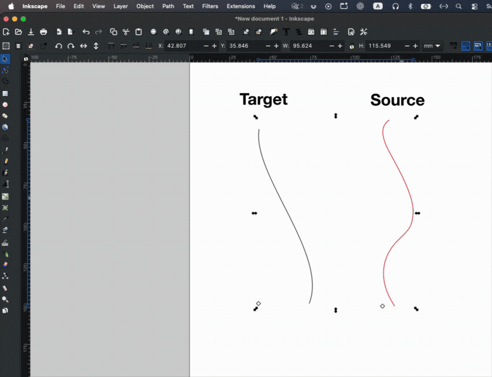

# Transfer Node Spacing

Inkscape extension that copies node spacing from one path onto another. Distances are arc lengths along the path. Select the spacing path and an open two-node curve together. The two-node path receives the nodes; the other path supplies the distances. Shapes need **Object → Object to Path** first.



## Install

Clone this repository into Inkscape’s user extensions folder, then restart Inkscape. The command is **Extensions → Modify Path → Transfer Node Spacing**. The same folder is listed under **Edit → Preferences → System → User extensions**. Create it if it is missing.

### macOS

```bash
cd "$HOME/Library/Application Support/org.inkscape.Inkscape/config/inkscape/extensions"
git clone https://github.com/soswow/inkscape-transfer-node-spacing.git
```

### Linux

```bash
cd "$HOME/.config/inkscape/extensions"
git clone https://github.com/soswow/inkscape-transfer-node-spacing.git
```

### Windows

Command Prompt:

```bat
cd %APPDATA%\inkscape\extensions
git clone https://github.com/soswow/inkscape-transfer-node-spacing.git
```

PowerShell:

```powershell
cd $env:APPDATA\inkscape\extensions
git clone https://github.com/soswow/inkscape-transfer-node-spacing.git
```

## Dialog

**Distance mode.** *Same arc length from the start* places each node at the same distance along the curve. Distances past the curve’s end are skipped. If the curve is longer, the spacing path’s last measured node sits before the curve’s own end. *Scale spacing to the curve length* maps the spacing path’s full length onto the curve’s full length.

**Measure spacing from.** First or last node of the spacing path. That end is distance zero and node 1. The spacing path stays as it is.

**Add nodes on the curve from.** First or last node of the curve. Last node reverses the curve, so the old last node becomes the first.

**Number nodes.** A black dot and a number on every node of both paths. Node 1 is the end chosen above, so the same number is the same distance on both paths. On a closed spacing path, Last node keeps the start as 1 and numbers the other way around the loop.

**Segment lengths.** Arc length at the middle of each segment, on both paths.

**Units.** Unit on the segment-length labels: mm, cm, in, px, or pt.

**Text size (px).** Height of the debug text. Default is 10.

**Text offset (px).** Gap from the curve to the nearest side of a label. Default is 12. Labels sit outside the filled shape. On a straight path they sit on the right of the direction of travel, and stay on that side when the paths were drawn opposite ways.

**Text alignment.** Horizontal, along the curve, or along the curve turned −90°. Rotation follows the numbering, from 1 toward 2. With −90°, the top of a label points back toward the lower number.

Each path gets one group (`Node spacing debug: spacing path` and `Node spacing debug: curve`). Run the extension again with both checkboxes off to remove them.

**Live preview** is the checkbox at the bottom of the dialog. Cancel discards the preview.

## License

GNU General Public License v3. See [LICENSE](LICENSE).
